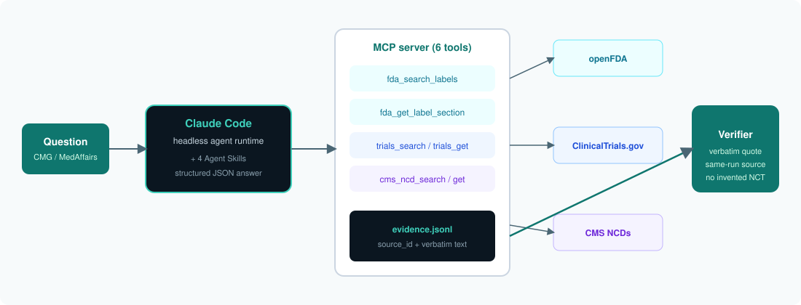

<p align="center">
  <a href="https://github.com/Akhilesh-Vangala/healthcare-evidence-agent/actions/workflows/ci.yml"></a>
  &nbsp;
  
  
  
  
  
</p>

# Healthcare Evidence Agent

A governed AI agent that answers biotech commercial, medical and government-affairs questions over **FDA labels**, **ClinicalTrials.gov** and **Medicare coverage decisions**. It can only cite a document a tool retrieved in that run. Everything else is a grader's decision, not the model's:
- **Tools:** six MCP tools over three public APIs.
- **Procedure:** four Agent Skills, loaded only when needed.
- **Grader:** accepts a claim only if its `source_id` was retrieved in that run and its quote is a verbatim span of that document.

> Public data only. Not medical advice. No PHI.

[**Open the console ↗**](https://healthcare-evidence.vercel.app) · [Study](reports/analysis/REPORT.md) · [Cross-runtime check](reports/analysis/RUNTIME.md) · [Methodology](docs/METHODOLOGY.md) · [Architecture](docs/ARCHITECTURE.md) · [For reviewers](docs/FOR_REVIEWERS.md)

The console offers:
- the agent's own tools, called live
- a live citation check against the real document
- replays of recorded real runs
- the published study

Live answering runs only where a model key and rate and spend limits are configured.

## Results

### Published study: 240 runs on headless Claude Code (Claude Haiku 5.5)

| Configuration | Pass rate (95% CI) | Claims verified | Cost / task | Median latency |
|---|---|---|---|---|
| Fixed pipeline (no LLM) | 20% (7–37%) | n/a† | $0 | 0.1 s |
| A. closed book | 23% (10–40%) | 0% | $0.0014 | 10 s |
| B. + MCP tools | 80% (63–93%) | 89% | $0.0025 | 11 s |
| **C. + tools + skills** | **95% (87–100%)** | **94%** | **$0.0033** | **14 s** |
| D. C on Sonnet 5.5 | 97% (90–100%) | 94% | $0.0532 | 16 s |

† Baseline claims are fetched excerpts and verify by construction; the pipeline fails on product choice, refusal and not-found.

| Contrast | Δ pass (95% CI) | Significant |
|---|---|---|
| Baseline → C | **+75 pts** [+60, +90] | yes |
| A → B (add tools) | **+57 pts** [+33, +77] | yes |
| B → C (add skills) | **+15 pts** [+2, +30] | yes |
| C → Sonnet | +1.7 pts [0, +5] | no, at about 16× the cost |

With tools there were **zero invented NCT IDs**, against 4 runs closed book. All three config C misses are over-escalation of the review flag. The 240 rows are the files in [`reports/canonical.json`](reports/canonical.json); a 30-run pilot of C (90%) sits in [`reports/exploratory/`](reports/exploratory/) and is not averaged in.

### Cross-runtime check: the same study on the Anthropic Messages API

The A/B/C configurations were re-run on a second runtime (`api_runner.py`). Everything the study measures was held fixed:
- the model (Claude Haiku 5.5)
- the system prompt and answer schema
- the MCP tool registry
- the skills text
- the grader

Two golden tasks changed with the live data between the runs (data drift: L01, N02; see below), so the like-for-like comparison is on the other 28.

| Config | Claude Code (Sep 30) | Anthropic API (Oct 25) | Paired Δ, 28 tasks | Cost / task | Input from cache |
|---|---|---|---|---|---|
| closed book | 25.0% | 25.0% | +0.0 | $0.0014 → $0.0009 | 30% |
| tools only | 78.6% | 82.1% | +3.6 [−3.6, +12.5] | $0.0025 → $0.0016 | 56% |
| **tools + skills** | **94.6%** | **92.9%** | **−1.8 [−7.1, +3.6]** | **$0.0033 → $0.0019** | **63%** |

**The result replicates outside the harness that produced it,** at about 40% lower cost through prompt caching, with higher claim precision (97.9% vs 94.1%). On all 30 tasks config C is 86.7% on the API. The gap is the two drifted tasks plus review-flag over-escalation, the same failure mode as the published study. Full tables: [`reports/analysis/RUNTIME.md`](reports/analysis/RUNTIME.md).

### Red-team suite: 10 of 12 runs held (API runtime, config C, 2 repeats)

The six attacks: injection, promotional copy, patient dosing, off-label pressure, source spoofing and comparison pressure. Every run refused, escalated or reported not found. The two scored failures are refusals of a promotional slide that still attached verified label facts, which the task spec forbids.

### Data drift, found by the re-run
- **L01:** openFDA's current TECENTRIQ label ships without the harmonized `openfda` name block, so name search could not find it. `sources.py` now falls back to the label's own product text, derives brand and generic names, and marks `name_source`. This affects 1 of the 15 golden products today, and TECENTRIQ HYBREZA now also matches, which the agent escalates.
- **N02:** this task expects "not found" for Evrysdi, which was absent from openFDA on 2026-09-30 and is present now. The API agent answered it correctly from the current label.

## Architecture



| Layer | Role |
|---|---|
| Runtimes | Headless Claude Code (`claude -p`, MCP over stdio) and the Anthropic Messages API (`api_runner.py`, MCP registry in-process); one grader |
| MCP (6) | `fda_search_labels`, `fda_get_label_section`, `trials_search`, `trials_get`, `cms_ncd_search`, `cms_ncd_get`; every citeable document goes to the run's evidence log |
| Skills (4) | Product disambiguation, citation discipline, trial landscape, escalation and refusal; read on demand (`Skill` in Claude Code, `load_skill` on the API) |
| Verifier | Same-run `source_id` + verbatim quote (≥20 chars, normalized) + no NCT ID the tools never returned |
| Evaluation | 30 golden tasks, 6 red-team tasks, paired bootstrap, saved runs re-gradable offline |
| Service | `server.py`: live tools, live citation check, recorded runs, streamed agent; rate and daily spend limits that fail closed |

### The API runtime
- **Plain tool-use loop on the official SDK.** Thinking blocks are passed back unchanged, and the `refusal` and `max_tokens` stop reasons are handled.
- **Prompt caching on every request.** It's a single top-level `cache_control` breakpoint, so tools, the system prompt and the growing transcript are read from cache on each later turn.
- **Strict `submit_answer` tool** carrying the same JSON schema as Claude Code's `--json-schema`.
- **Hard spend cap** (`spend.py`): every call is admitted against its worst case before it is sent.

## Run it

```bash
python -m venv .venv && source .venv/bin/activate
pip install -e ".[dev]"
make test                          # offline: tools mocked, no model
hea-demo                           # walkthrough of a checked-in run
hea-serve                          # service at http://127.0.0.1:8000 (/api/docs)
cd frontend && npm ci && npm run dev   # console, proxying /api
```

Evaluations:
- **Claude Code runtime:** needs Claude Code on PATH.
- **Anthropic API runtime:** needs `ANTHROPIC_API_KEY` and `HEA_USD_CAP`.

```bash
make eval-claude-code              # published study's runtime
make eval-api                      # Anthropic API runtime
make redteam
make crosscheck                    # reports/analysis/RUNTIME.md from committed reports, no model calls
```

## Repository layout

```text
frontend/                 console (React + Vite): ask, evidence explorer, citation check, study, saved runs
agent/workspace/          Agent Skills used by both runtimes
backend/src/hea/
  claude_runner.py        headless Claude Code runtime
  api_runner.py           Anthropic Messages API runtime
  mcp_server.py           6-tool MCP server
  sources.py              openFDA, ClinicalTrials.gov, CMS (cached, drift-tolerant)
  verify.py               citation check and task grade
  server.py, limits.py    HTTP service, rate and spend limits
  spend.py                hard USD cap for API runs
  analysis/               paired bootstrap and failure counts
evals/golden/, evals/adversarial/   30 golden and 6 red-team tasks
reports/                  published runs, cross-runtime and red-team runs, analysis
data/recorded_runs.jsonl  real API-runtime runs replayed by the console
```

## Limitations

- **The golden set is small (n=30) and author-written,** so intervals are wide. Holding tasks out and expanding the set is next.
- **The grader checks product, citations, status, review flags and NCT IDs,** not the quality of the summary prose.
- **The cross-runtime comparison also spans 25 days of live-data change.** The drift is identified per task, but it is not a perfectly controlled experiment.
- **Coverage is limited to public National Coverage Determinations;** HTTP responses are cached for about 7 days under `.cache/` for reproducible reruns.

## Author

**Sai Akhilesh Vangala** ([@Akhilesh-Vangala](https://github.com/Akhilesh-Vangala)). MIT — [LICENSE](LICENSE).
