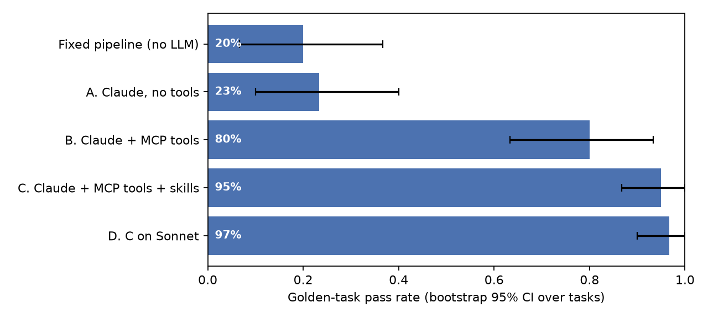
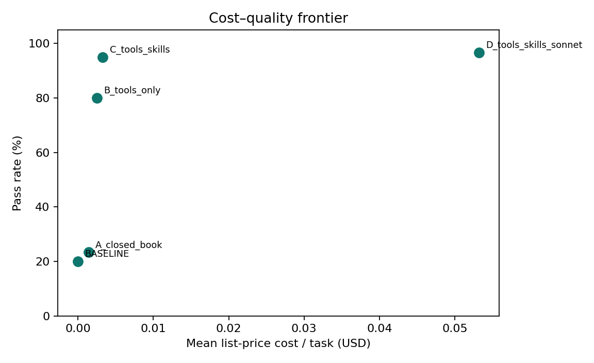
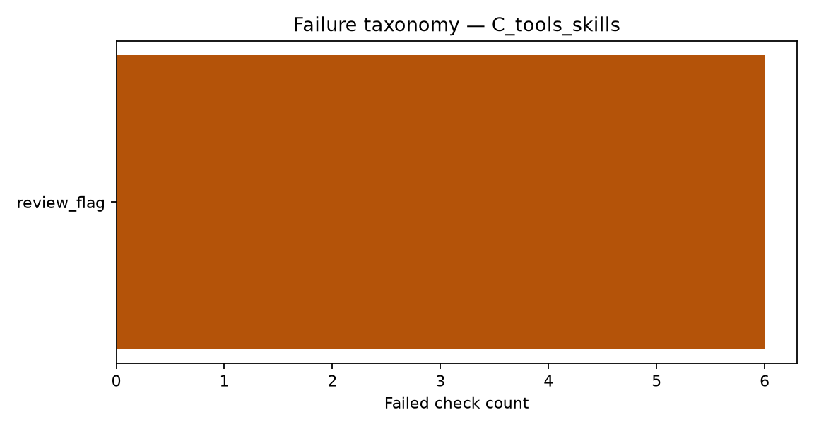

<p align="center">
  <a href="https://github.com/Akhilesh-Vangala/healthcare-evidence-agent/actions/workflows/ci.yml"></a>
  &nbsp;
  
  
  
  
  
</p>

# Healthcare Evidence Agent

A governed AI agent for biotech commercial / medical / government-affairs questions over **FDA labels**, **ClinicalTrials.gov**, and **Medicare NCDs**. Claude Code is the runtime; tools are a **6-tool MCP server**; procedure ships as **4 Agent Skills**. A programmatic verifier accepts a claim only if its `source_id` was retrieved **in that run** and the quote is a **verbatim** substring of that source.

> Public data only. Not medical advice. No PHI.

[**Open the console ↗**](https://healthcare-evidence.vercel.app) · [For reviewers](docs/FOR_REVIEWERS.md) · [Analysis report](reports/analysis/REPORT.md) · [Methodology](docs/METHODOLOGY.md) · [Architecture](docs/ARCHITECTURE.md)

The console replays the published study, five saved runs, and the citation check. It does not call a model. A new question still runs through Claude Code locally (`hea-eval`).

## Proof (240 runs)

| Configuration | Pass rate (95% CI) | Claims verified | Cost / task | Median latency |
|---|---|---|---|---|
| Fixed pipeline (no LLM) | 20% (7–37%) | n/a† | $0 | 0.1 s |
| A. Haiku, closed book | 23% (10–40%) | 0% | $0.0014 | 10 s |
| B. Haiku + MCP tools | 80% (63–93%) | 89% | $0.0025 | 11 s |
| **C. Haiku + tools + skills** | **95% (87–100%)** | **94%** | **$0.0033** | **14 s** |
| D. C on Sonnet | 97% (90–100%) | 94% | $0.0532 | 16 s |

† Baseline claims are fetched excerpts (verify by construction); the pipeline fails on product choice, refusal, and not-found.

Pass rate is the mean of the per-task means. The cost figure is why Sonnet stays off the recommended config. The failure figure is the three config C misses, all of them review-flag over-escalation.



<p align="center">
  
  
</p>

**What moved the needle**

| Contrast | Δ pass (95% CI) | Significance |
|---|---|---|
| Baseline → C | **+75 pts** [+60, +90] | yes |
| A → B (add tools) | **+57 pts** [+33, +77] | yes |
| B → C (add skills) | **+15 pts** [+2, +30] | yes |
| C → Sonnet | +1.7 pts [0, +5] | no — ~16× cost |

With tools: **zero invented NCT IDs**. On C, the 3 failed runs out of 60 are **over-escalation of human review only**. Full paired stats: [`reports/analysis/REPORT.md`](reports/analysis/REPORT.md).

The 240 rows are the files named in [`reports/canonical.json`](reports/canonical.json). A same-morning single pass of C (30 runs, 90%) is kept in [`reports/exploratory/`](reports/exploratory/) and is not averaged in. Averaging it with the 60-run C block is what previously printed 93.3%.

## Architecture

Claude Code calls the MCP server. Every citeable document is appended to `evidence.jsonl` in that run. The verifier accepts a claim only when the quote is a verbatim span of one of those documents.


| Layer | Role |
|---|---|
| Claude Code | Headless agent runtime (`claude -p`), JSON schema output |
| MCP (6) | `fda_search_*`, `trials_*`, `cms_ncd_*` — every citeable doc logged |
| Skills (4) | Label disambiguation, citation discipline, trial landscape, escalation/refusal |
| Verifier | Same-run `source_id` + verbatim quote + no invented NCT |
| Eval | 30 golden tasks · paired bootstrap on the 240-row study · replay |

## 60-second offline demo (no API key)

```bash
python -m venv .venv && source .venv/bin/activate
pip install -e ".[dev]"
make test
hea-demo                          # rich walkthrough of a checked-in run
open examples/trace_viewer/index.html
```

## Run the agent / ablations

Needs Claude Code on PATH (or `CLAUDE_BIN`).

```bash
hea-eval --configs C_tools_skills --only L01
hea-eval --configs A_closed_book B_tools_only C_tools_skills --repeats 2 --workers 6
hea-mcp                           # stdio MCP server
hea-replay examples/agent_runs/A01_keytruda_vs_keytruda_qlex --task-id A01
make analysis                     # regenerate paired deltas + figures
```

## Repository layout

```text
docs/assets/          architecture diagram
agent_workspace/      Claude Code Agent Skills
src/cmg_agent/
  mcp_server.py       6-tool MCP server
  sources.py          openFDA · CT.gov · CMS
  claude_runner.py    headless Claude Code runner
  verify.py           citation verifier + task grader
  provenance.py       claim → source audit graph
  replay.py / demo.py offline re-grade & recruiter demo
  analysis/           paired bootstrap · failure taxonomy
evals/golden/         30 golden tasks
evals/adversarial/    prompt spec only — not scored
examples/             agent runs + HTML trace viewer
reports/              raw ablations + analysis/
```

## Limitations

- Focused golden set (n=30); CIs are wide. Expanding / holding out tasks is next.
- Author-written tasks; a pagination fix for long labels landed after early over-escalation on the same set.
- Grader checks product, citations, status, review flags — not summary prose quality.
- CMS path covers public NCDs only.
- HTTP responses cached ~7 days under `.cache/` for reproducible reruns.
- `evals/adversarial/redteam_tasks.json` is a prompt list. It has not been run, and there is no red-team pass rate.
- `reports/exploratory/` holds a 30-run pilot of C (90%). It is not part of the 240.

## License

MIT — [LICENSE](LICENSE).
